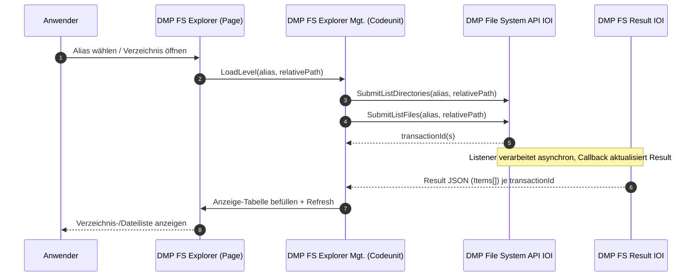
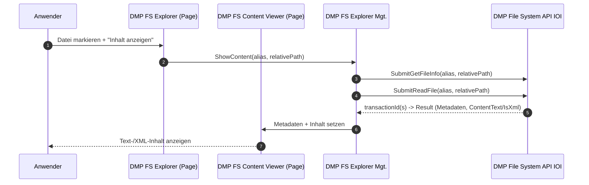

# Anforderungen – BC Dateisystem-Explorer (File Services Demo)

> Zweck: Demonstration der in [DataMigratePro-FileServices-Dokumentation.md](DataMigratePro-FileServices-Dokumentation.md), [DataMigratePro-FileServices-Implementation.md](DataMigratePro-FileServices-Implementation.md) und [DataMigratePro-FileServices-FactSheet.md](DataMigratePro-FileServices-FactSheet.md) beschriebenen File-Services-Funktionalität anhand eines interaktiven Dateisystem-Explorers in Business Central (BC).

## 1. Kontext und Ziel

Es soll eine BC-Extension („**DMP File System Explorer**") entstehen, die einen **Dateisystem-Explorer** direkt in Business Central bereitstellt. Der Explorer nutzt ausschließlich den bestehenden, alias-basierten File-Services-Contract der App **DataMigrate Pro** und macht ihn für Anwender interaktiv bedienbar.

Der Explorer soll drei Kernaufgaben abdecken:

1. **Navigation & Darstellung** – Verzeichnisstruktur und Dateiliste eines konfigurierten Alias laden und darstellen.
2. **Dateioperationen** – typische Datei- und Verzeichnisoperationen (Kopieren, Verschieben, Löschen, Anlegen, Archivieren, Schreiben) aus der Oberfläche anstoßen.
3. **Inhalt ansehen** – Dateiinhalte (Text/XML) laden und im BC-Client anzeigen.

Die Funktionalität ist als **Beispiel-Implementierung** gedacht und zeigt, wie eine BC-Extension den stabilen Action-Contract der File Services wiederverwendet.

## 2. Abhängigkeit (Dependency)

Die neue Extension bindet **DataMigrate Pro** als Abhängigkeit ein. Der folgende Eintrag ist in `dependencies` der `app.json` der neuen Extension zu ergänzen (Werte aus [app.json.text](app.json.text)):

```json
"dependencies": [
  {
    "id": "87b41ac4-158e-4748-a31f-34d1176a2982",
    "name": "DataMigrate Pro",
    "publisher": "IO Integrated",
    "version": "27.1.175.0"
  }
]
```

Rahmenbedingungen aus der Basis-App:

- `application`: `27.0.0.0`, `platform`: `1.0.0.0`, `runtime`: `16.0`.
- Die neue Extension nutzt einen **eigenen** `idRanges`-Bereich (nicht den Bereich `72359575–72359624` der Basis-App).
- Genutzte öffentliche Objekte der Basis-App:
  - `codeunit 72359617 "DMP File System API IOI"` (Submit*-Methoden, `RetryRequest`, XML-Hooks)
  - `table 72359615 "DMP FS Request IOI"` (Request-Lifecycle)
  - `table 72359616 "DMP FS Result IOI"` (Result-Lifecycle inkl. `Error Code`, `Message`)
  - `page 72359618 "DMP FS Request List IOI"`, `page 72359619 "DMP FS Result List IOI"`

## 3. Scope

### 3.1 In Scope

- BC-Rollencenter-/Menü-Einstieg zum Öffnen des Explorers.
- Alias-Auswahl (aus den konfigurierten `FileSystemAliases`).
- Laden und Darstellen von Unterverzeichnissen (`ListDirectories`) und Dateien (`ListFiles`) für einen Alias + relativen Pfad.
- Navigation in Ebenen (in Unterverzeichnis wechseln, eine Ebene zurück, zur Wurzel).
- Anzeige von Datei-Metadaten (`GetFileInfo`): Größe, Zeitstempel (UTC), Endung, Read-Only.
- Anzeige von Dateiinhalten (`ReadFile`): Text- und XML-Darstellung.
- Anstoßen von Dateioperationen aus der Oberfläche: `WriteFile`, `AppendFile`, `CopyFile`, `MoveFile`, `DeleteFile`, `ArchiveFile`.
- Anstoßen von Verzeichnisoperationen: `CreateDirectory`, `DeleteDirectory`, `DirectoryExists`, `FileExists`.
- Statusrückmeldung pro Aktion über die vorhandenen Request-/Result-Tabellen (asynchrones Ergebnis via Callback).
- Aktualisieren (Refresh) der Ansicht nach Abschluss eines Kommandos.

### 3.2 Out of Scope

- Änderungen am Listener, `FileSystemService`, Transport-Envelope oder Callback (`Upload_CommitFsResult`) – die Basis-App bleibt unverändert.
- Direkter Zugriff über absolute Pfade oder nicht konfigurierte Aliase.
- Konfiguration der Aliase/Policy selbst (erfolgt in `settings.json` des Listeners).
- Operationen außerhalb der unterstützten Kommandoliste (z. B. Berechtigungsänderungen, Symlinks).
- Lizenz-/Sicherheitslogik – diese verbleibt vollständig im Listener (Alias-Whitelist, Traversal-Schutz, Policy).

## 4. Rahmenbedingungen und Annahmen

- Der DataMigratePro-Listener läuft im Service-Bus-Modus (`-t listen`) und ist mit `FileSystemAliases`/`FileSystemSecurity` konfiguriert.
- Alle Operationen sind **asynchron**: Ein `Submit*`-Aufruf liefert eine `transactionId`; das Endergebnis trifft später per Callback ein und aktualisiert `DMP FS Request IOI`/`DMP FS Result IOI`.
- Der Explorer arbeitet **rein alias-relativ**: Anwender wählen einen Alias und navigieren über relative Pfade; absolute Pfade werden nie aus BC gesendet.
- Sicherheitsverletzungen (Traversal, unerlaubte Endung, Größenlimit) werden vom Listener mit stabilen Fehlercodes beantwortet und im Explorer angezeigt.

## 5. Funktionale Anforderungen (FR)

| ID | Titel | Beschreibung | Priorität | Zugrundeliegende API | Akzeptanzregel |
|---|---|---|---|---|---|
| FR-101 | Alias auswählen | Anwender wählt einen konfigurierten Alias als Explorer-Wurzel. | Must | `FileSystemAliases` | Nur konfigurierte Aliase sind auswählbar; Auswahl setzt relativen Pfad auf Wurzel. |
| FR-102 | Verzeichnisse laden | Unterverzeichnisse des aktuellen Pfads werden geladen und dargestellt. | Must | `SubmitListDirectories(alias, relativePath)` | Ergebnisliste zeigt alle Unterverzeichnisse (`Items`). |
| FR-103 | Dateien laden | Dateien des aktuellen Pfads werden geladen und dargestellt. | Must | `SubmitListFiles(alias, relativePath)` | Ergebnisliste zeigt alle Dateien (`Items`). |
| FR-104 | In Verzeichnis navigieren | Anwender öffnet ein Unterverzeichnis und aktualisiert die Ansicht. | Must | `SubmitListDirectories`, `SubmitListFiles` | Relativer Pfad wird erweitert; Ansicht zeigt Inhalt der neuen Ebene. |
| FR-105 | Ebene zurück / zur Wurzel | Navigation eine Ebene höher bzw. zurück zur Alias-Wurzel. | Must | – (lokale Pfadlogik) | Relativer Pfad wird korrekt gekürzt; Ansicht aktualisiert. |
| FR-106 | Datei-Metadaten anzeigen | Metadaten einer markierten Datei werden angezeigt. | Should | `SubmitGetFileInfo(alias, relativePath)` | Größe, UTC-Zeitstempel, Endung, Read-Only werden dargestellt. |
| FR-107 | Dateiinhalt anzeigen | Inhalt einer markierten Datei wird geladen und angezeigt. | Must | `SubmitReadFile(alias, relativePath)` | `ContentText`/`ContentBase64` verfügbar; XML wird erkannt (`IsXml`). |
| FR-108 | Datei schreiben | Neue Datei oder Überschreiben aus der Oberfläche. | Must | `SubmitWriteFile(alias, relativePath, content)` | Datei entsteht mit erwarteter Größe; Result `Completed`. |
| FR-109 | Datei anhängen | Inhalt an bestehende Datei anhängen. | Should | `SubmitAppendFile(alias, relativePath, content)` | Anhang wird ergänzt; Größe wächst entsprechend. |
| FR-110 | Datei kopieren | Datei in Ziel-Alias/-Pfad kopieren. | Must | `SubmitCopyFile(srcAlias, srcPath, tgtAlias, tgtPath)` | Zieldatei entsteht; Quelle bleibt erhalten. |
| FR-111 | Datei verschieben | Datei in Ziel-Alias/-Pfad verschieben. | Must | `SubmitMoveFile(srcAlias, srcPath, tgtAlias, tgtPath)` | Zieldatei entsteht; Quelle entfällt. |
| FR-112 | Datei archivieren | Datei in Archiv-Alias/-Pfad verschieben. | Should | `SubmitArchiveFile(srcAlias, srcPath, archiveAlias, archivePath)` | Datei liegt im Archiv; Quelle entfällt. |
| FR-113 | Datei löschen | Markierte Datei löschen (mit Bestätigung). | Must | `SubmitDeleteFile(alias, relativePath)` | Datei entfällt; Ansicht wird aktualisiert. |
| FR-114 | Verzeichnis anlegen | Neues Unterverzeichnis im aktuellen Pfad anlegen. | Should | `SubmitCreateDirectory(alias, relativePath)` | Verzeichnis existiert nach Ausführung. |
| FR-115 | Verzeichnis löschen | Verzeichnis löschen (rekursiv nur, wenn Policy erlaubt). | Should | `SubmitDeleteDirectory(alias, relativePath, recursive)` | Verzeichnis entfällt bzw. Policy-Ablehnung wird angezeigt. |
| FR-116 | Existenzprüfung | Prüfen, ob Datei/Verzeichnis existiert. | Could | `SubmitFileExists`, `SubmitDirectoryExists` | `Exists`-Ergebnis wird angezeigt. |
| FR-117 | XML Import-Quelle | XML-Datei über XML-Port-Alias lesen. | Could | `SubmitImportXmlPortSource(alias, relativePath)` | Verhalten wie `ReadFile`. |
| FR-118 | XML Export-Ziel | XML-Inhalt über XML-Port-Alias schreiben. | Could | `SubmitExportXmlPortTarget(alias, relativePath, xml)` | Verhalten wie `WriteFile`. |
| FR-119 | Statusverfolgung | Laufende Aktionen werden mit Status/Fehlercode nachverfolgt. | Must | `DMP FS Request IOI`, `DMP FS Result IOI` | Status `Created→Sent→Completed/Failed`; `Error Code`/`Message` sichtbar. |
| FR-120 | Fehlgeschlagene Aktion wiederholen | Fehlerhafte Requests erneut senden. | Should | `RetryRequest(TransactionId)` bzw. Page-Aktion | Nur `Failed`-Einträge werden erneut gesendet. |
| FR-121 | Ansicht aktualisieren | Explorer nach Kommando-Abschluss neu laden. | Must | erneutes `ListDirectories`/`ListFiles` | Ansicht spiegelt den aktuellen Zustand des Alias-Pfads. |

## 6. Nicht-funktionale Anforderungen (NFR)

| ID | Kategorie | Anforderung | Messgröße | Grenzwert |
|---|---|---|---|---|
| NFR-101 | Kompatibilität | Basis-App (DataMigrate Pro) bleibt unverändert; nur öffentliche Objekte werden konsumiert. | Änderungen an Basis-App | 0 |
| NFR-102 | Sicherheit | Nur alias-relative Pfade werden gesendet; keine absoluten Pfade aus BC. | Absolute Pfade im Envelope | 0 |
| NFR-103 | Robustheit | Asynchrone Ergebnisse werden korrekt zugeordnet und angezeigt, auch bei Verzögerung. | Zuordnung via `transactionId` | 100 % |
| NFR-104 | Bedienbarkeit | Aktueller Alias + relativer Pfad sind jederzeit sichtbar (Breadcrumb/Pfadanzeige). | Pfadanzeige vorhanden | ja |
| NFR-105 | Nachvollziehbarkeit | Jede angestoßene Aktion ist über `transactionId` im Request/Result auffindbar. | Auffindbarkeit | 100 % |
| NFR-106 | Fehlertransparenz | Stabile Fehlercodes des Listeners werden dem Anwender verständlich angezeigt. | Fehleranzeige | alle Codes abgedeckt |
| NFR-107 | Performance | Große Inhalte werden über `Payload/Result Truncated`-Hinweise kenntlich gemacht. | Truncation-Hinweis | angezeigt |

## 7. Feature-Liste

| Feature-ID | Feature-Name | Zugeordnete Anforderungen | Beschreibung |
|---|---|---|---|
| FEAT-101 | Explorer-Navigation | FR-101–FR-105, FR-121, NFR-104 | Alias-Auswahl, Verzeichnis-/Dateiladen, Ebenen-Navigation, Refresh. |
| FEAT-102 | Inhalts-/Metadatenansicht | FR-106, FR-107, FR-117, NFR-107 | Metadaten und Text-/XML-Inhalt einer Datei anzeigen. |
| FEAT-103 | Dateioperationen | FR-108–FR-113, FR-118 | Schreiben, Anhängen, Kopieren, Verschieben, Archivieren, Löschen, XML-Export. |
| FEAT-104 | Verzeichnisoperationen | FR-114–FR-116 | Anlegen, Löschen, Existenzprüfung. |
| FEAT-105 | Statusmonitor & Retry | FR-119, FR-120, NFR-103, NFR-105, NFR-106 | Status-/Fehlerverfolgung und Wiederholung fehlgeschlagener Aktionen. |

## 8. Umsetzungsdesign (BC-Extension)

### 8.1 Zielbild (fachlich)

Der Anwender öffnet den Explorer, wählt einen Alias und sieht die Verzeichnis-/Dateiliste. Über Aktionen stößt er Datei-/Verzeichnisoperationen an oder öffnet eine Inhaltsansicht. Jede Aktion erzeugt einen Request an den Listener; das Ergebnis trifft asynchron per Callback ein und aktualisiert Status und Ansicht.

### 8.2 Vorgeschlagene AL-Objekte (Beispiel-Extension, eigener ID-Bereich)

| Objekt | Typ | Aufgabe | Nutzt |
|---|---|---|---|
| `DMP FS Explorer` | Page (Kartenteil/List) | Hauptoberfläche: Alias-Auswahl, Pfadanzeige, Verzeichnis-/Dateiliste, Aktionen. | `SubmitListDirectories`, `SubmitListFiles` |
| `DMP FS Explorer Entry` | Table (temporär) | In-Memory-Darstellung der aktuellen Ebene (Name, Typ, Größe, geändert). | Ergebnis aus `ListFiles`/`ListDirectories` |
| `DMP FS Content Viewer` | Page | Anzeige von Metadaten und Text-/XML-Inhalt einer Datei. | `SubmitReadFile`, `SubmitGetFileInfo` |
| `DMP FS Explorer Mgt.` | Codeunit | Ablauflogik: Pfadhandling, Aufruf der API, Ergebnis-Parsing (JSON), Refresh. | `"DMP File System API IOI"` |
| `DMP FS Explorer RC Ext.` | PageExtension | Menüeinstieg im Rollencenter. | – |

> Hinweis: Die Ergebnisdaten der `List*`-Kommandos treffen asynchron über die Result-Tabelle ein. Die Explorer-Verwaltung liest das Ergebnis-JSON aus `DMP FS Result IOI` und befüllt die temporäre Anzeigetabelle. Alternativ kann für die reine Darstellung ein Ereignis-Hook/Refresh-Muster genutzt werden.

### 8.3 Ablauf (Beispiel: Verzeichnis öffnen)



### 8.4 Ablauf (Beispiel: Dateiinhalt ansehen)



### 8.5 Zuordnung Explorer-Aktion → API-Kommando

| Explorer-Aktion | API-Aufruf |
|---|---|
| Öffnen/Aktualisieren | `SubmitListDirectories`, `SubmitListFiles` |
| Inhalt anzeigen | `SubmitReadFile` (+ `SubmitGetFileInfo`) |
| Metadaten | `SubmitGetFileInfo` |
| Neue Datei / Überschreiben | `SubmitWriteFile` |
| Anhängen | `SubmitAppendFile` |
| Kopieren | `SubmitCopyFile` |
| Verschieben | `SubmitMoveFile` |
| Archivieren | `SubmitArchiveFile` |
| Datei löschen | `SubmitDeleteFile` |
| Verzeichnis anlegen | `SubmitCreateDirectory` |
| Verzeichnis löschen | `SubmitDeleteDirectory` |
| Existenz prüfen | `SubmitFileExists`, `SubmitDirectoryExists` |
| XML importieren | `SubmitImportXmlPortSource` |
| XML exportieren | `SubmitExportXmlPortTarget` |

## 9. Traceability-Matrix (Anforderung → Feature → Umsetzung → Test)

| Anforderung | Feature | Umsetzung (Objekt) | Testfall | Status |
|---|---|---|---|---|
| FR-101 | FEAT-101 | `DMP FS Explorer` (Alias-Auswahl) | TC-101 | Offen |
| FR-102/103 | FEAT-101 | `DMP FS Explorer Mgt.` (List*) | TC-102 | Offen |
| FR-104/105 | FEAT-101 | Pfadlogik in Mgt. | TC-103 | Offen |
| FR-106 | FEAT-102 | `SubmitGetFileInfo` | TC-104 | Offen |
| FR-107 | FEAT-102 | `DMP FS Content Viewer` | TC-105 | Offen |
| FR-108/109 | FEAT-103 | `SubmitWriteFile`/`SubmitAppendFile` | TC-106 | Offen |
| FR-110/111/112 | FEAT-103 | `SubmitCopyFile`/`SubmitMoveFile`/`SubmitArchiveFile` | TC-107 | Offen |
| FR-113 | FEAT-103 | `SubmitDeleteFile` | TC-108 | Offen |
| FR-114/115/116 | FEAT-104 | Verzeichniskommandos | TC-109 | Offen |
| FR-117/118 | FEAT-102/103 | XML-Port-Kommandos | TC-110 | Offen |
| FR-119/120 | FEAT-105 | Request/Result + `RetryRequest` | TC-111 | Offen |
| FR-121 | FEAT-101 | Refresh nach Kommando | TC-112 | Offen |

## 10. Testfälle

| Testfall-ID | Bezug | Vorbedingung | Testschritte | Erwartetes Ergebnis | Status |
|---|---|---|---|---|---|
| TC-101 | FR-101 | Alias `IMPORT` konfiguriert | Explorer öffnen, Alias wählen | Nur konfigurierte Aliase wählbar; Wurzel geladen | Offen |
| TC-102 | FR-102/103 | Alias-Verzeichnis mit Inhalt | Ebene laden | Verzeichnisse und Dateien werden dargestellt | Offen |
| TC-103 | FR-104/105 | Mehrstufige Struktur | In Unterordner navigieren, zurück, zur Wurzel | Pfad und Inhalt aktualisieren korrekt | Offen |
| TC-104 | FR-106 | Datei vorhanden | Metadaten aufrufen | Größe, UTC-Zeit, Endung, Read-Only korrekt | Offen |
| TC-105 | FR-107 | XML-Datei vorhanden | Inhalt anzeigen | Text/XML sichtbar; `IsXml` korrekt | Offen |
| TC-106 | FR-108/109 | Alias beschreibbar | Schreiben, dann Anhängen | Datei entsteht/wächst; Result `Completed` | Offen |
| TC-107 | FR-110/111/112 | Quelle + Ziel-Alias | Kopieren/Verschieben/Archivieren | Ziel entsteht; Quelle je Kommando erhalten/entfällt | Offen |
| TC-108 | FR-113 | Datei vorhanden | Löschen mit Bestätigung | Datei entfällt; Ansicht aktualisiert | Offen |
| TC-109 | FR-114/115/116 | Alias-Verzeichnis | Anlegen/Löschen/Existenz prüfen | Ergebnisobjekt (`Created`/`Deleted`/`Exists`) korrekt | Offen |
| TC-110 | FR-117/118 | XML-Alias konfiguriert | Import-Quelle/Export-Ziel | Verhalten wie `ReadFile`/`WriteFile` | Offen |
| TC-111 | FR-119/120 | Fehlerhafter Request | Fehler erzeugen, Retry ausführen | Status/Fehlercode sichtbar; Retry sendet nur `Failed` | Offen |
| TC-112 | FR-121 | Kommando abgeschlossen | Refresh auslösen | Ansicht spiegelt aktuellen Zustand | Offen |
| TC-113 | NFR-102 | Traversal-Versuch | `..` im relativen Pfad | Listener liefert `ACCESS_DENIED`; Anzeige des Fehlers | Offen |

## 11. Abnahmekriterien

| AK-ID | Bezug | Kriterium | Nachweismethode |
|---|---|---|---|
| AK-101 | FR-101–FR-105 | Explorer navigiert alias-relativ durch Verzeichnisse und Dateien. | Funktionstest |
| AK-102 | FR-106/107 | Metadaten und Text-/XML-Inhalt werden korrekt angezeigt. | Funktionstest |
| AK-103 | FR-108–FR-116 | Alle Datei-/Verzeichnisoperationen sind aus der Oberfläche auslösbar. | Funktionstest je Kommando |
| AK-104 | FR-119/120 | Status, Fehlercode und Retry sind nachvollziehbar. | Request/Result-Log |
| AK-105 | NFR-101/102 | Basis-App unverändert; nur alias-relative Pfade. | Review + Negativtest |

Given/When/Then (Beispiele):

> **Given** ein konfigurierter Alias `IMPORT` mit Unterordnern und Dateien
> **When** der Anwender den Alias wählt und ein Unterverzeichnis öffnet
> **Then** zeigt der Explorer die Verzeichnisse und Dateien der gewählten Ebene an.

> **Given** eine markierte XML-Datei
> **When** der Anwender „Inhalt anzeigen" ausführt
> **Then** wird der Text-/XML-Inhalt im Content Viewer dargestellt und `IsXml` ist korrekt gesetzt.

> **Given** ein `relativePath` mit `..`-Traversal
> **When** der Anwender eine Operation anstößt
> **Then** wird das Kommando vom Listener mit `ACCESS_DENIED` abgelehnt und der Fehler im Explorer angezeigt.

## 12. Offene Punkte

- Festlegung des eigenen `idRanges`-Bereichs der Beispiel-Extension.
- Darstellungsmuster für asynchrone Ergebnisse der `List*`-Kommandos (Polling der Result-Tabelle vs. Ereignis-Hook).
- Umfang der Inhaltsanzeige (nur Text/XML vs. zusätzlich Base64-Download großer Dateien).
